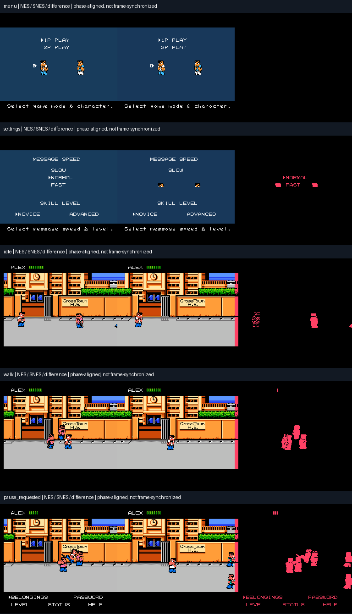
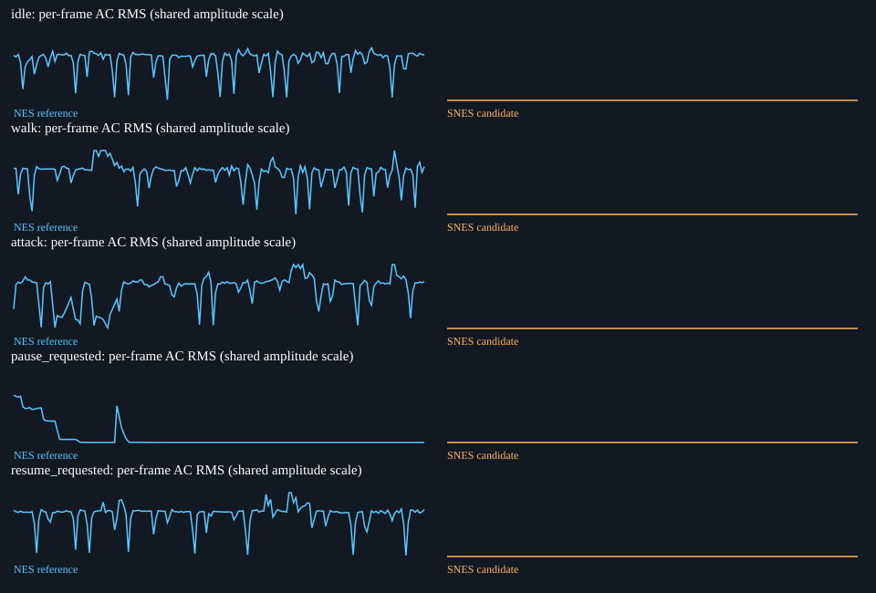
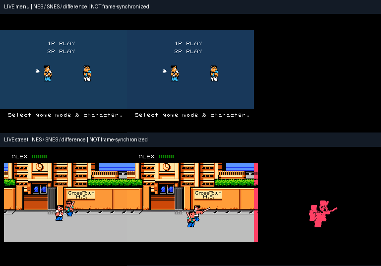
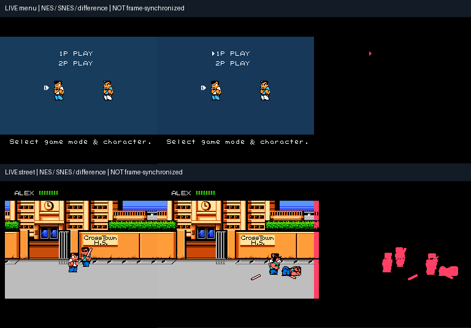
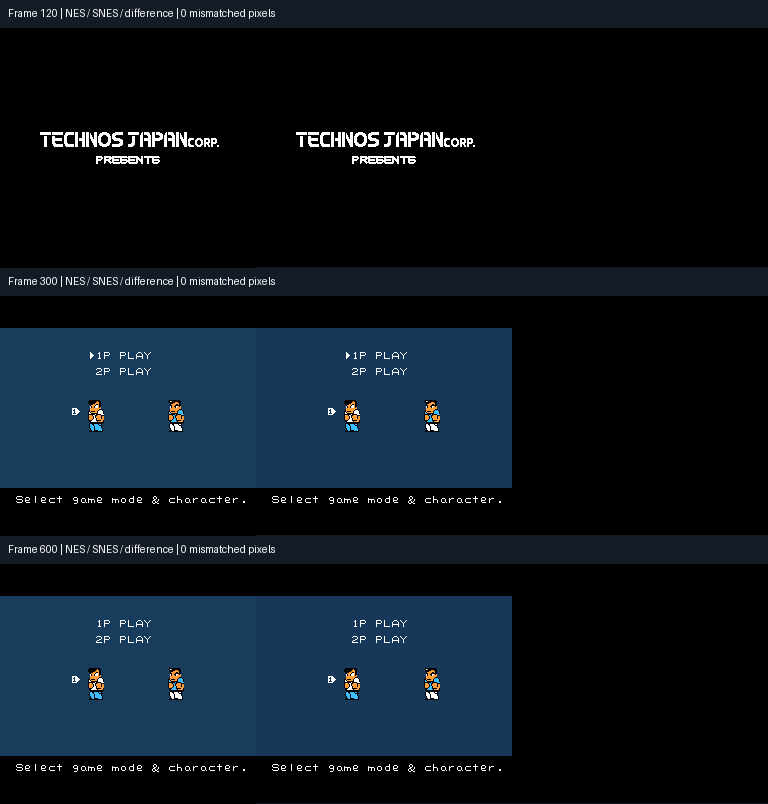

# Visual audit checkpoint

Private development evidence. No ROMs or raw game assets are published here.
The layout follows the Penta Dragon DX audit approach: reference/candidate/diff
collages, exact evidence hashes and human verdicts attached to those hashes.

## Quality benchmark — nine failing gates

The latest [original-versus-port harness](../BENCHMARK.md) reproduces slow
transitions, dead gameplay audio and the settings-screen heads/missing text.
This is evidence from the existing build, not another playable-build handoff.





[Gate results](quality/report.json) · [NES receipt](quality/nes-capture.json) ·
[SNES receipt](quality/snes-capture.json) · [Select adapter receipt](quality/select-receipt.json)

The local dashboard has recorded audio and phase-seek controls; audio files are
not included in this private GitHub summary. See the benchmark runbook to reproduce.

## Live game execution — incomplete

Latest: bounded NMI and incremental dirty-row updates. Visible picture changes
rose from 1.77 to 11.45/second in the scripted walk; game/audio timing is still
incorrect. See the [timing analysis](../INTERRUPT-VALIDATION.md).



[Latest evidence](incremental/audit.json) ·
[Baseline pacing](pacing-before.json) · [Incremental pacing](pacing-after.json) ·
[Latest 12,000-frame soak](incremental-soak.json)

### Previous full-rebuild checkpoint

Original game code runs on the SNES CPU, advances through menus into the street,
and supplies the SPC700 NES sound engine. These are **not screenshot fixtures**.
NES and SNES input/frame schedules are not synchronized, and scrolling, raster
HUD behavior, speed and audio fidelity remain incomplete. Scores expose the
differences; the live audit correctly does not claim a visual/gameplay pass.



[Evidence](live/audit.json) · [Menu receipt](live/menu-receipt.json) ·
[Street receipt](live/street-receipt.json) · [12,000-frame soak receipt](soak-receipt.json)

## Renderer-only fixtures — three pixel passes

These separately test original CHR, nametables, attributes, sprites and palette
conversion on native SNES hardware. Each comparison has zero RGB555 mismatches
over the top 239 NES rows. This does **not** prove gameplay or timing compatibility.



[Renderer evidence](renderer/audit.json)

## Review and reproduce

GitHub renders these collages privately. Download/open the corresponding
`incremental/index.html`, `live/index.html` or `renderer/index.html`, or use the loopback server in the
[runbook](../DEVELOPMENT.md), for zoomable images and per-evidence review notes.
Export review JSON before sharing feedback. GitHub itself does not execute the HTML.

```sh
python3 tools/verify_audit.py docs/audit/live
python3 tools/verify_audit.py docs/audit/incremental
python3 tools/verify_audit.py docs/audit/renderer
python3 tools/verify_benchmark.py docs/audit/quality --summary
```

Public Pages is disabled. Automatic approval review rejected public publication
from the private repository; explicit visibility approval is still required.
