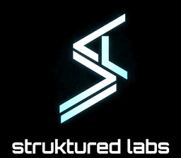
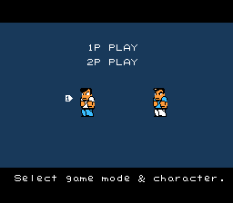
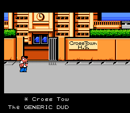
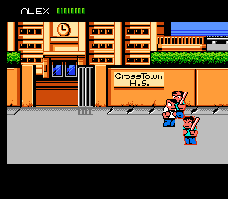
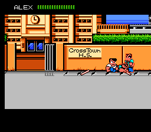

# River City Ransom SNES — v0.9.0 beta

A native Super Nintendo port of *River City Ransom* (NES, Technōs Japan, 1989),
by **struktured labs**. It is distributed only as a patch for the original US NES ROM.








*Screenshots: native 256×224, Mesen2, build 4294. Build 4302 looks the same apart from the Gamer stamina bar.*

## What it is

The original game code runs natively on the SNES 65816 CPU; it is not an emulator
cartridge. Graphics are converted to SNES tile, sprite and palette formats. The NES
sound driver runs unchanged, and the SNES audio chip plays it through an SPC700
2A03 sound engine. The result is a 2 MB HiROM/FastROM SNES cartridge image that
runs on SNES emulators, flash carts and the MiSTer SNES core.

This is a **beta**. The game can be played, but the known issues listed below are
still being worked on.

## Features

- **Native SNES port** of the full NES game. Maps, enemies, shops and bosses are
  the original game's.
- **Four difficulty levels** on the SKILL LEVEL screen. Press Left/Right to cycle
  Novice → Intermediate → Advanced → Gamer.
  - *Novice* and *Advanced* are the original NES settings.
  - *Intermediate* is new: enemies get +8, between Novice and Advanced.
  - *Gamer* is new and hard. Enemies get +32. Enemy combat and will stats can reach
    127 and stamina 255 (the NES caps are 63/127). Your own caps also rise to 127/255,
    and agility above 63 actually makes you faster. You can still win at the original
    63/127 stats; shopping past them is optional.
  - Your chosen difficulty is remembered in cartridge SRAM.
- **Gamer gang outline.** On Gamer, gang members get a red outline so you can tell
  them apart in a crowd.
- **SNES rumble on MiSTer.** Rumble works on a port-1 controller with the MiSTer SNES
  core (20260603 or newer, SNAC off), using the SNES Rumble protocol. Landing or
  blocking a hit, and hitting a downed enemy, each give a short pulse. Without a rumble pad,
  nothing changes.
- **MiSTer savestates.** The MiSTer SNES core's save states work with this port.
- **SPC audio.** The original NES music and sound effects play through the SNES APU
  using the 2A03 SPC700 engine by Memblers, in the updated version from
  Myself086's Project Nested (MIT licence; see Third-party notices).
- **struktured labs** splash screen at boot, with its own sound.

## How to patch

You need your own copy of the **US NES ROM**. This download does not include it.

| | |
|---|---|
| No-Intro name | `River City Ransom (USA).nes` |
| Size (with iNES header) | 262,160 bytes |
| CRC32 (file, with header) | `C3508F7E` |
| SHA-1 (file, with header) | `A8612A36D9D2739D2B321B6EBB97C2757CCCA410` |
| CRC32 (ROM, without header) | `E9C387EC` |
| SHA-1 (ROM, without header) | `CA794E6A2B0ECF69B2BE1753D379CCE6434C49D7` |

1. Check that your ROM matches. Most dumps include the 16-byte iNES header
   (`4E 45 53 1A 08 10 40 00 …`), so the file CRC32 is `C3508F7E`.
2. Apply `river-city-ransom-snes-v0.9.0-beta.bps` with
   [Floating IPS (Flips)](https://github.com/Alcaro/Flips),
   [Rom Patcher JS](https://www.marcrobledo.com/RomPatcher.js/) or beat.
   If your ROM has no header (CRC32 `E9C387EC`), use
   `river-city-ransom-snes-v0.9.0-beta-headerless.bps` instead.
3. Name the output something like `River City Ransom SNES v0.9.0 beta.sfc`.
   It should match:

| Patched SNES ROM | |
|---|---|
| Size | 2,097,152 bytes (2 MB, no copier header) |
| CRC32 | `2351783E` |
| SHA-1 | `778FDB9CF8A8FF4EC572AF2F9F92FD5F9CB932EB` |
| SHA-256 | `3d8b611292ff615290195ea9d3f79669cafba051cdffd8b0cafab2557cb85f16` |

BPS checks the input and output checksums. If the patcher reports a checksum
error, the ROM is the wrong one: a different region, a revision, an already-modified
file, or the wrong header variant for the patch you chose.

## Tested on

| Platform | Status |
|---|---|
| Mesen2 2.1.1 | All automated checks pass, including boot, menus, street play, Gamer outline and rumble output. |
| snes9x (libretro, Sep 2026) | All automated checks pass, including rumble output. |
| MiSTer SNES core 20260603 | This core version supports the rumble protocol. Earlier builds of this port were played on MiSTer. Build 4299 was checked with a Limited Run SNAC controller and build 4301 with savestates. Build 4302 is still to be confirmed on MiSTer with a rumble pad. |
| Real SNES / flash cart | Earlier builds were played on an EverDrive. Build 4302 is still to be confirmed on hardware. |

The internal cartridge title reads `RCR NATIVE CPU PROOF`. This is expected in
this beta.

## Controls

| SNES | Action |
|---|---|
| D-pad | Move (double-tap to run) |
| B | Punch |
| Y | Kick |
| A | Jump (same as pressing Y+B) |
| Y+B | Jump (the original NES button combination) |
| Start | Pause / status menu |
| Select | Select (as on NES) |

Player 2 uses controller 2 with the same layout. Rumble works on controller 1 only.

## Known issues (v0.9.0 beta)

- **Audio:** some occasional popping or sputtering, and short silences in places
  ([#6](https://github.com/struktured-labs/river-city-ransom-snes/issues/6)).
- **Speed:** game speed has not been certified to match the NES everywhere. Busy
  scenes such as the park can slow down, and a two-player fight can hitch
  ([#5](https://github.com/struktured-labs/river-city-ransom-snes/issues/5)).
- **Graphics:** stale or garbage sprites can appear for a moment; some mall NPCs look
  wrong ([#8](https://github.com/struktured-labs/river-city-ransom-snes/issues/8)).
- **Shops:** some shop text, colours and the YES/NO prompt differ from the NES
  ([#9](https://github.com/struktured-labs/river-city-ransom-snes/issues/9));
  stat gains are not shown right away
  ([#16](https://github.com/struktured-labs/river-city-ransom-snes/issues/16)).
- **Status screen:** some Present Status values can show blank
  ([#4](https://github.com/struktured-labs/river-city-ransom-snes/issues/4)).
- **Passwords:** the original 33-character NES passwords are unchanged. Stats above
  the NES limits (Gamer or Intermediate) cannot be saved in a password yet. SRAM
  stores the difficulty setting only, not a full save.
- **Controls:** there is no controller-preset menu yet
  ([#12](https://github.com/struktured-labs/river-city-ransom-snes/issues/12)), and
  the Limited Run SNAC controller is confirmed working on MiSTer (4299); other SNAC
  controllers are untested
  ([#11](https://github.com/struktured-labs/river-city-ransom-snes/issues/11)).
- **Rumble:** port 1 only; it needs the MiSTer SNES core with SNAC off.
- The AI-controlled Player 2 companion from development builds is **not** in this
  release.

Please report bugs with the build number (4302), your emulator or hardware, and
steps to reproduce.

## Credits

- **struktured labs** (Carmelo Piccione): port, native CPU translation, difficulty
  modes, Gamer outline, rumble, tools and testing.
- **Joey Parsell (Memblers)**, with assistance from **Kevin Horton** and others:
  the original 2A03 SPC700 sound engine ("SPC700 APU emulator (c)2001-2003").
- **Myself086 (Laurent Courville)**, [Project Nested](https://github.com/Myself086/Project-Nested):
  the updated version of that engine used in this release (MIT licence, revision
  `cc2c892`).
- **Patrick Areny ([upernes](https://github.com/mandraga/upernes))**: the
  reference for NES-on-SNES audio delivery.
- **Rumbleminze** ([nes-to-snes-template](https://github.com/rumbleminze/nes-to-snes-template)):
  NES-to-SNES porting approach (inspiration; no code used).
- **infidelity**: porting guidance.
- **Limited Run Games**: SNES Rumble protocol (reference; implemented independently).
- **MiSTer SNES core** developers, for rumble support in the core.
- Testing tools: **Mesen2**, **snes9x**, **FCEUX**.
- *River City Ransom* © 1989 Technōs Japan. The rights now belong to Arc System Works.
  This is an unofficial, non-commercial fan project with no affiliation, and it
  ships no copyrighted ROM data.

## Third-party notices

The SPC700 sound engine comes from Project Nested
(https://github.com/Myself086/Project-Nested) and is used under this licence:

```
Copyright 2020 Laurent Courville

Permission is hereby granted, free of charge, to any person obtaining a copy of
this software and associated documentation files (the "Software"), to deal in
the Software without restriction, including without limitation the rights to
use, copy, modify, merge, publish, distribute, sublicense, and/or sell copies of
the Software, and to permit persons to whom the Software is furnished to do so,
subject to the following conditions:

The above copyright notice and this permission notice shall be included in all
copies or substantial portions of the Software.

THE SOFTWARE IS PROVIDED "AS IS", WITHOUT WARRANTY OF ANY KIND, EXPRESS OR
IMPLIED, INCLUDING BUT NOT LIMITED TO THE WARRANTIES OF MERCHANTABILITY, FITNESS
FOR A PARTICULAR PURPOSE AND NONINFRINGEMENT. IN NO EVENT SHALL THE AUTHORS OR
COPYRIGHT HOLDERS BE LIABLE FOR ANY CLAIM, DAMAGES OR OTHER LIABILITY, WHETHER
IN AN ACTION OF CONTRACT, TORT OR OTHERWISE, ARISING FROM, OUT OF OR IN
CONNECTION WITH THE SOFTWARE OR THE USE OR OTHER DEALINGS IN THE SOFTWARE.
```

## Changelog

- **v0.9.0 beta (build 4302)**: first public release.
  - Fix: on Intermediate and Gamer, a boss spawn could write its stats into Alex or
    the other enemy, giving wrong stats, odd stamina-bar behaviour, near-zero boss
    stamina and garbled passwords (#27; 4300).
  - Gamer mode: late bosses no longer spawn with 1 stamina; boosted stamina stops at
    255 (#31; 4302).
  - MiSTer: save states with the MiSTer SNES core now work (#30; 4301).
  - MiSTer: the Limited Run SNAC controller now works (4299).
  - Fix: the game could freeze for good during a room change in the middle of a
    fight (an interrupt could run with the wrong data bank; 4295).
  - Gamer mode: the HUD stamina bar now scales over the full 0–255 range (4295).
  - Rumble on controller 1 with the MiSTer SNES core (SNES Rumble protocol) (4294).
  - Gamer mode: red gang outline around the whole metasprite silhouette (4292).
  - Intermediate and Gamer difficulty levels; the chosen skill is kept in SRAM (4163/4260).
  - struktured labs splash with its own sound (4146).
  - Native CPU port with SPC700 audio, FastROM, and camera/scroll and audio
    timing work (up to 4108).
